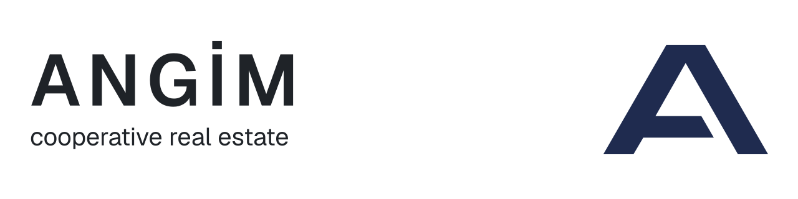

  <picture>
    <source media="(prefers-color-scheme: dark)" srcset="https://raw.githubusercontent.com/angim-as/.github/main/profile/assets/banner-dark.svg">
    
  </picture>

  <a href="https://angim.com.tr"><picture><source media="(prefers-color-scheme: dark)" srcset="https://raw.githubusercontent.com/angim-as/.github/main/profile/assets/badges/angim-com-tr-dark.svg"></picture></a>
  <picture><source media="(prefers-color-scheme: dark)" srcset="https://raw.githubusercontent.com/angim-as/.github/main/profile/assets/badges/ankara-turkiye-dark.svg"></picture>
  <picture><source media="(prefers-color-scheme: dark)" srcset="https://raw.githubusercontent.com/angim-as/.github/main/profile/assets/badges/real-estate-development-dark.svg"></picture>

---

### About

ANGİM develops residential and commercial properties, offering high-standard homes and workplaces to its members and the public at fair prices. The company grew out of a long tradition of cooperative investment and pairs that shared-capital model with contemporary urban development.

Its portfolio includes seven projects across Ankara and Bodrum.

### What we stand for

| | |
|---|---|
| **Reliability** | Transparent, accountable management of our partners' savings. |
| **Quality** | Aesthetic and technical excellence in every project. |
| **Sustainability** | Value that lasts beyond the handover. |
| **Collective intelligence** | Decisions shaped by the people they serve. |

### On GitHub

This organization hosts the open-source tools we build and use in our engineering work. Issues and pull requests are welcome; see the [contributing guide](https://github.com/angim-as/.github/blob/main/CONTRIBUTING.md) and the [security policy](https://github.com/angim-as/.github/blob/main/SECURITY.md) before you start.
